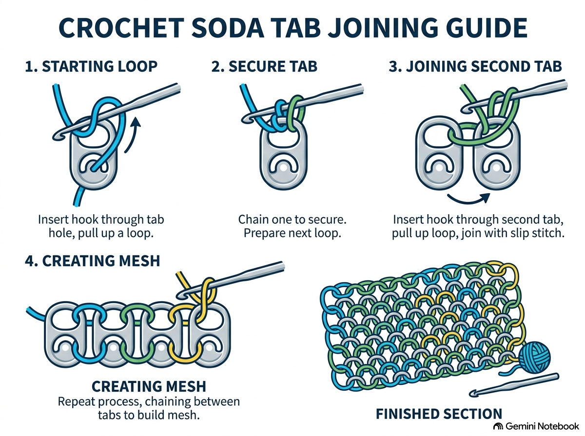
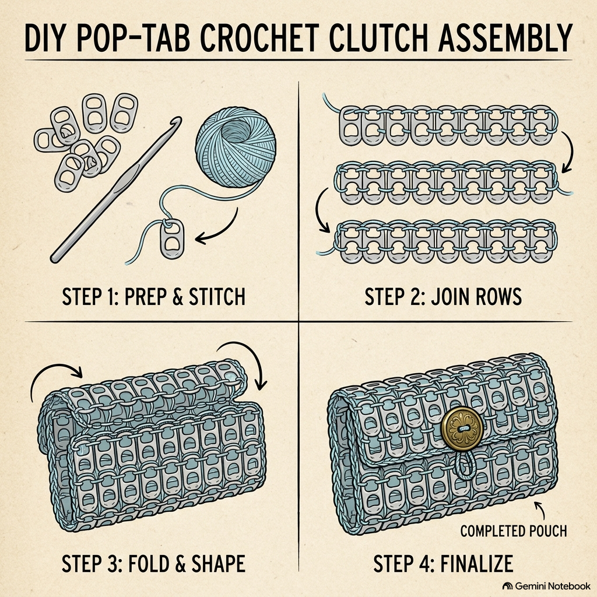
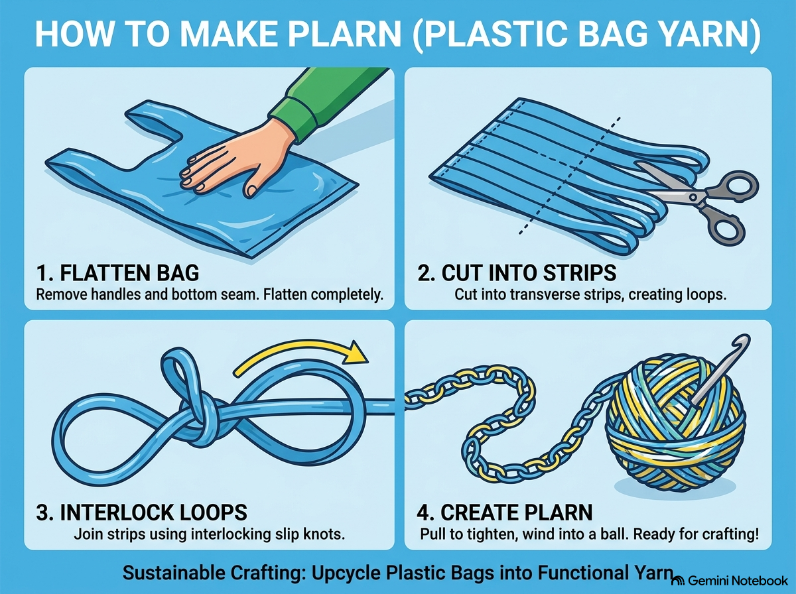
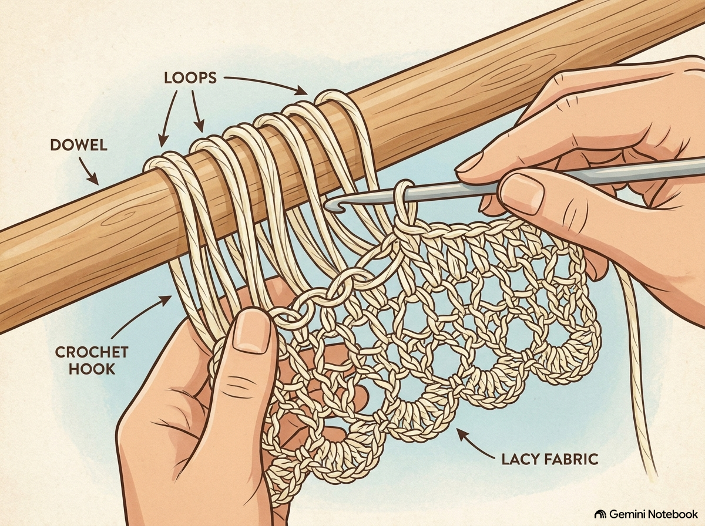
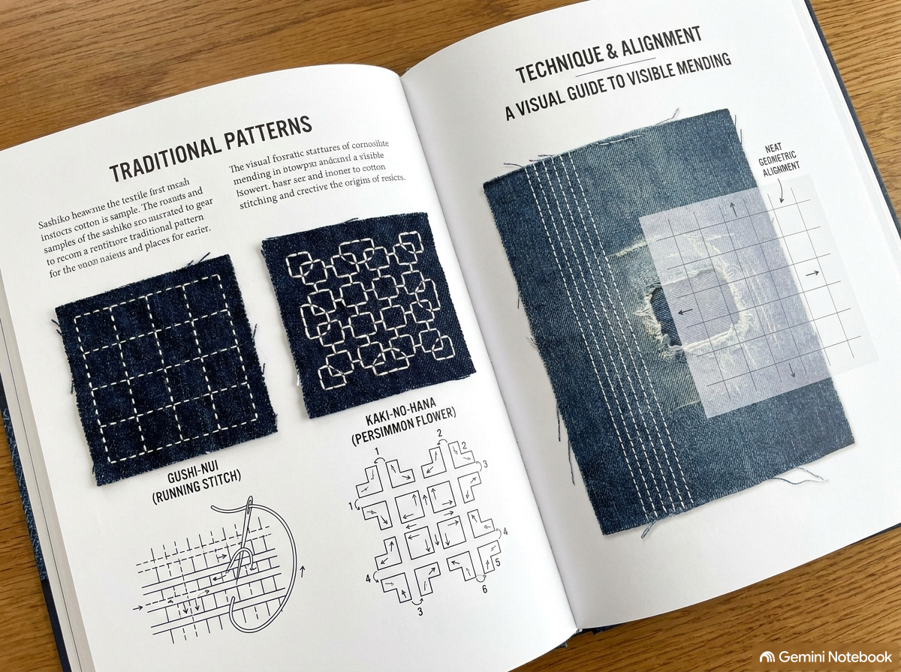
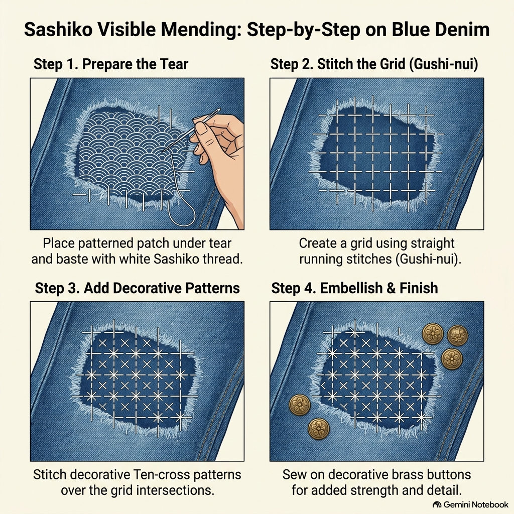
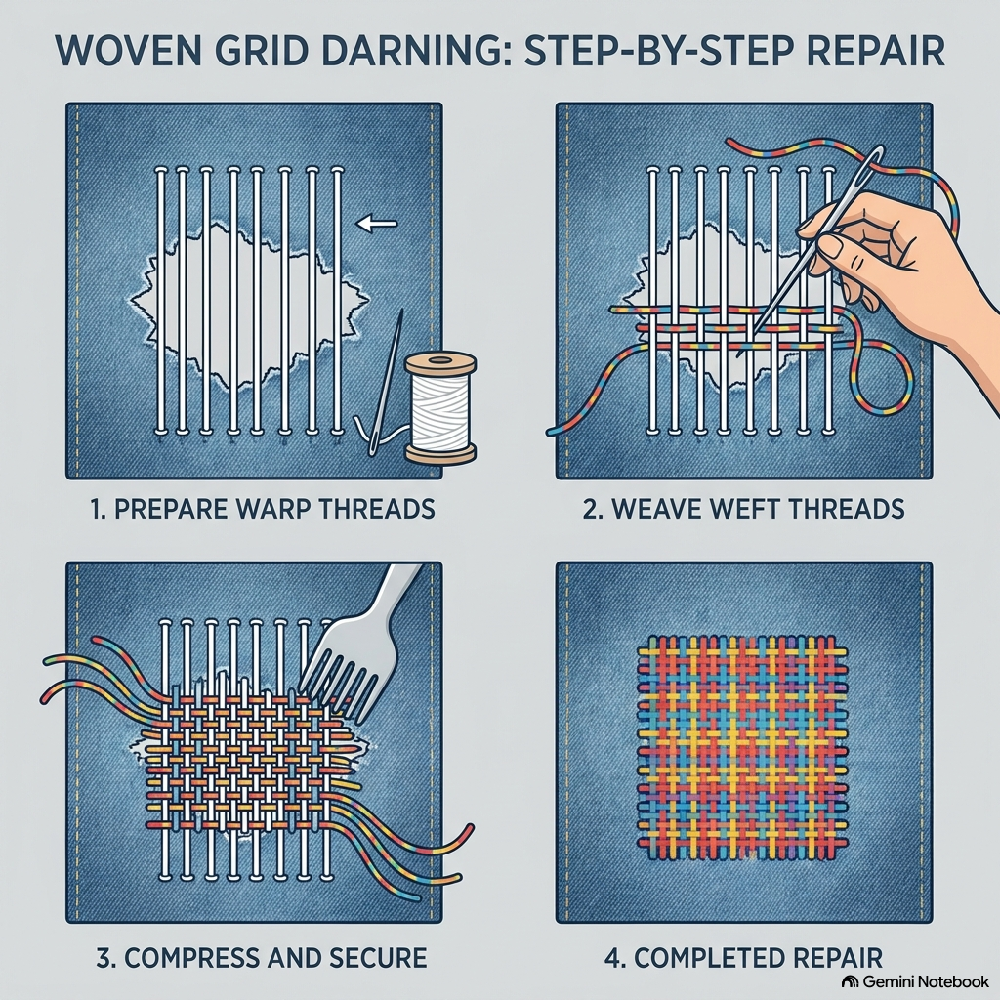
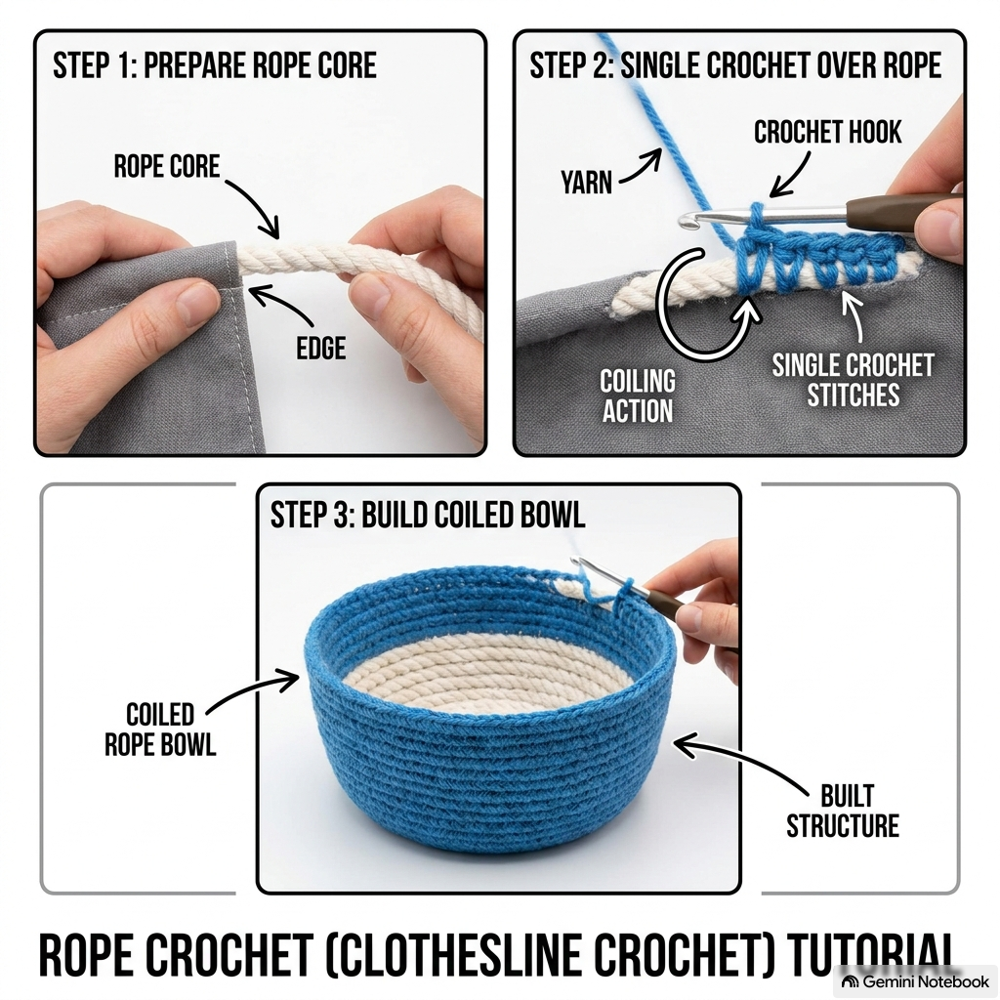

# Extreme Customization Guide: Non-Traditional Fiber Arts, Upcycling & Alternative DIY

This repository contains a comprehensive guide and visual diagrams for non-traditional crochet, alternative fiber arts, and low-sew customization techniques to transform discarded materials into wearable alternative fashion and functional home goods.

---

## Table of Contents
1. [Module 1: Metal & Hardware Upcycling](#module-1-metal--hardware-upcycling)
2. [Module 2: Alternative Yarns (Plarn, T-Shirt Yarn & Trash Crafting)](#module-2-alternative-yarns-plarn-t-shirt-yarn--trash-crafting)
3. [Module 3: Low-Sew & No-Sew Garment Transformation](#module-3-low-sew--no-sew-garment-transformation)
4. [Module 4: Decorative Visible Mending (Sashiko & Darning)](#module-4-decorative-visible-mending-sashiko--darning)
5. [Module 5: Practical Household Customization & Utilities](#module-5-practical-household-customization--utilities)

---

## Module 1: Metal & Hardware Upcycling

### 1.1 Pop-Tab Crochet Mesh & Garments
Aluminum soda pull-tabs (*lacres de latinha*) can be interlocked into flexible metallic mesh using standard crochet stitches.

* **Preparation:** Wash tabs thoroughly in warm, soapy water. Use wire cutters or a file to smooth away sharp burrs where the tab was detached from the can.
* **Basic Joining Technique:** Work single crochet (sc) stitches through the top smooth holes of two overlapping tabs. Slide a third tab beneath the second, locking them together with 2 sc per hole. Repeat to form horizontal strips, then interlock rows vertically.
* **Applications:** Interlocked sheets can be assembled into crop tops, statement jackets, clutches, belts, and jewelry.

### 1.2 3D Hexagonal Pop-Tab Storage Baskets
Pop-tabs can be arranged in six-sided geometric layouts to build rigid, structural 3D containers and trinket boxes.

1. **Center Motif:** Join 6 pop-tabs in a central ring using single crochet stitches in the inner holes.
2. **Expanding Rounds:** Add outer rounds of 30 tabs grouped in sets of six sides.
3. **Assembly:** Construct 24 matching side strips (6 tabs each) and stitch them together with tapestry needles and durable poly-yarn to form rigid hex walls and matching lids.

### 1.3 Found Objects & Hardware Integration
* **PET Bottle & Washer Framing:** Crochet single stitches around flat metal washers, PET bottle rings, or key rings to form rigid geometric coasters and wall mandalas.
* **Roadside Treasures (Dropped Earrings, Buttons, Charms):** Use found roadside trinkets as centerpieces for 6-tab floral brooches or embed them into pop-tab mesh junctions.

---

## Module 2: Alternative Yarns (Plarn, T-Shirt Yarn & Trash Crafting)

### 2.1 Making Plastic Bag Yarn (*Plarn*)
*Plarn* turns plastic grocery bags into water-resistant fiber for outdoor goods and heavy-duty bags.

1. **Prep:** Flatten plastic grocery bags and trim off the handles and bottom seams.
2. **Strip Cutting:** Fold the remaining plastic cylinder lengthwise and slice it into 1-inch horizontal strips.
3. **Loop Joining:** Unfold the loops, slip-knot two loops through each other, and pull gently to form a continuous strand. Roll into a ball.

### 2.2 Applications for Plarn & T-Shirt Yarn (*Trapilho*)
* **Plarn Utility:** Crochet with a 6.0mm–8.0mm hook to make patio cushions, doormats, beach totes, and hanging planter baskets.
* **T-Shirt Yarn (*Trapilho*):** Slice old cotton t-shirts into continuous 1/2-inch fabric strips. Use large hooks/needles to craft heavy-duty floor poufs, pet beds, and laundry hampers.

---

## Module 3: Low-Sew & No-Sew Garment Transformation

### 3.1 No-Sew Distressing & Hardware Customization
* **Bleach Painting & Fabric Stenciling:** Apply stencils or freehand designs with bleach pens on dark t-shirts to create bold contrast graphics without sewing.
* **Cropping & Distressing:** Cut hemlines, shorten sleeves, and create slashed cutouts on oversized t-shirts or jeans.
* **Hardware Additions:** Attach metal studs, grommets, safety-pin chains, and iron-on patches to personalize jackets and footwear.

### 3.2 Hybrid Garment Edging (Crochet on Fabric)
Add lace borders, ruffles, or side panels directly to slashed jeans, shorts, or top hemlines.

1. **Prepping the Fabric Edge:** Thread a darning needle with yarn or thread. Work a row of evenly spaced blanket or chain stitches 1/4 inch from the raw slashed edge.
2. **Crocheting the Border:** Insert a crochet hook directly into the blanket stitch loops.
3. **Stitch Pattern:**
   * **Row 1:** `*Double crochet (dc) 1, chain 1, skip 1 stitch*` across to form a grid foundation.
   * **Row 2 (Frill Finish):** Work 2 double crochets into every stitch and chain space to create a ruffle.

---

## Module 4: Decorative Visible Mending (Sashiko & Darning)

### 4.1 Japanese Sashiko Stitching
Sashiko uses thick white cotton thread and long running stitches (*Gushi-nui*) to create geometric patterns over denim patches.

* **Basic Running Stitch Grid (*Gushi-nui*):**
  1. Pin a fabric patch behind the clothing tear.
  2. Mark a 1/2 cm grid using washable fabric chalk.
  3. Sew parallel rows of running stitches, loading multiple stitches onto a long needle at once.
* **Geometric Patterns (*Ten-Cross* & *Kaki-no-hana*):** Cross vertical stitch rows over horizontal rows to form flower or star intersections. Secure found beads or metal trinkets into stitch junctions for added texture.

### 4.2 Woven & Swiss Darning
* **Woven Grid Darning:** Lay down parallel vertical warp threads across a hole using a tapestry needle, then weave horizontal weft threads over-and-under to build a miniature woven patch.
* **Swiss Darning (Duplicate Stitch):** Follow the exact "V" loops of knitwear with contrasting yarn to reinforce worn sweater elbows and knees without altering texture.

---

## Module 5: Practical Household Customization & Utilities

### 5.1 Clothesline & Rope Crochet
Work standard single crochet stitches over a thick cotton clothesline or rope core. The rope gets trapped inside the stitches as you coil it in expanding rounds to construct self-supporting storage bowls, trays, and floor hampers.

### 5.2 Zero-Waste Home Crafts
* **Glass Jar & Can Upcycling:** Wrap empty food cans or glass jars with macramé cord, jute, or leftover yarn using silicone adhesive to create desk organizers, vases, and pencil holders.
* **Utility Goods:** Sew or knit reusable fleece/terrycloth duster heads, chair leg floor protectors, and fabric microwave bowl cozies.

---

## License
MIT License - Feel free to share, modify, and contribute!
